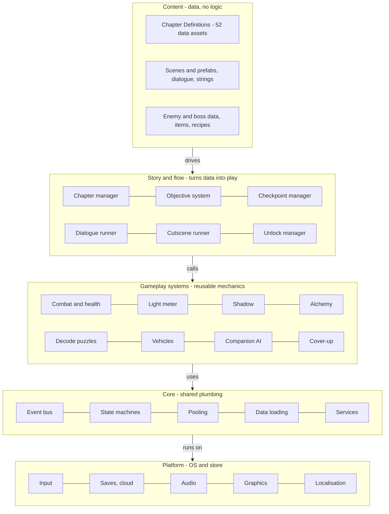

## 5. System architecture

The game is a client-only application built in five layers. Upper layers may depend on lower layers, never the reverse, and each layer is an assembly definition so dependencies are enforced by the compiler.

| Layer | Contents | Responsibility |
| --- | --- | --- |
| 1. Platform | Input, save and settings storage, localisation, audio engine, rendering, platform services (achievements, cloud save) | Everything that touches the operating system or store |
| 2. Core | Event bus, service locator, state machines, object pooling, time and pause control, data loading | Shared plumbing with no game rules |
| 3. Gameplay systems | Combat, health, light meter, Shadow, alchemy, decode puzzles, vehicles, companion AI, cover-up and disguise, hazards (quicksand, magma, wind) | Reusable mechanics that know nothing about specific chapters |
| 4. Story and flow | Chapter manager, objective system, dialogue and cutscene runner, checkpoint and fail-forward manager, unlock manager | Turns a Chapter Definition into a played chapter |
| 5. Content | Chapter Definitions (data), scenes, prefabs, enemy and boss definitions, dialogue scripts, string tables | The 52 chapters themselves |

layered architecture · 5 layers

**Reading the diagram.** Content is data. Story and flow reads it and orchestrates the gameplay systems, which in turn use the core services. Nothing in the content layer contains logic beyond what the systems expose; this is what makes a chapter correction cheap.

**Key design principles**

1. **Data-driven:** chapters, enemies, potions, fragments and unlocks are ScriptableObject assets, never hard-coded.

2. **Event-driven:** systems communicate through typed events on a bus (for example, FragmentCollected, ObjectiveCompleted, PlayerDowned), so adding a feature does not edit existing code.

3. **Composition over inheritance:** a boss is a character plus phase components, not a deep class tree.

4. **Deterministic save state:** the whole game state is a plain serialisable data object, so saves, checkpoints and automated tests use the same format.

5. **Fail-forward by construction:** the checkpoint manager is the only code allowed to handle failure; chapters declare rules, they do not implement them.

**Module responsibilities**

| Module | Responsibility | Key types |
| --- | --- | --- |
| ChapterManager | Loads the Chapter Definition, streams scenes, starts and ends a chapter | ChapterDefinition, ChapterRunner |
| ObjectiveSystem | Tracks the three-tier goals and fires completion events | Objective, ObjectiveTracker |
| CheckpointManager | Autosaves, restores, applies the fail-forward penalty rules | Checkpoint, FailureRule |
| DialogueRunner | Plays Yarn or Ink scripts with tone tags and subtitles | DialogueLine, ToneTag |
| CombatSystem | Hits, parry windows, health, light meter | Hitbox, HealthComponent, LightMeter |
| ShadowSystem | Shadow abilities, cooldowns, captured and evolved states | ShadowController, ShadowAbility |
| AlchemySystem | Gathering, crafting, potion effects | Recipe, PotionEffect |
| DecodeSystem | Map and inscription puzzles | DecodePuzzle |
| VehicleSystem | Balloon, flying transport, horse | VehicleController |
| CompanionAI | Follow, assist actions, scripted absences | CompanionBrain |
| CoverUpSystem | Awareness meter for Miss Keyhole style sections | AwarenessMeter |
| UnlockManager | Fragments, abilities, recipes, cosmetics | UnlockTable |
| SaveSystem | Versioned save files, migration, cloud sync | SaveData, SaveMigrator |
| SettingsAndAccessibility | Difficulty, subtitles, assists, remapping | SettingsProfile |

### Architecture diagram (text form)

