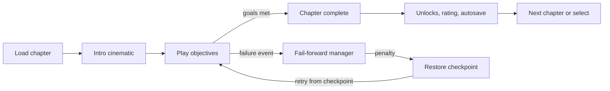

## 7. Coding guide with reference implementations

The original document printed reference skeletons in Unity C#. In this skill each skeleton is replaced by a complete implementation under `templates/unity/`, listed in the pointers below. Scenes are loaded by name through `SceneManager` by default; Addressables can be layered on top once the slice is stable.

### 7.1 Chapter Definition (the data contract)

**Authoritative implementation:** `templates/unity/Assets/Game/Runtime/Data/ChapterDefinition.cs` in this skill. The snippet printed in the original document was a reference skeleton; the template is the complete, compile-checked version and must be used instead.

### 7.2 Typed event bus

**Authoritative implementation:** `templates/unity/Assets/Game/Runtime/Core/EventBus.cs and Events.cs` in this skill. The snippet printed in the original document was a reference skeleton; the template is the complete, compile-checked version and must be used instead.

Subscribers must unsubscribe in OnDisable. The tests call Clear between runs so static state never leaks between test cases.

### 7.3 Fail-forward manager

**Authoritative implementation:** `templates/unity/Assets/Game/Runtime/Story/FailForwardManager.cs` in this skill. The snippet printed in the original document was a reference skeleton; the template is the complete, compile-checked version and must be used instead.

The rule that failure is never terminal lives here and nowhere else. Chapters only declare rules; this class is the single place that decides what failing means.

### 7.4 Shadow ability controller

**Authoritative implementation:** `templates/unity/Assets/Game/Runtime/Systems/ShadowController.cs` in this skill. The snippet printed in the original document was a reference skeleton; the template is the complete, compile-checked version and must be used instead.

Because Time.time stops when the game pauses, cooldowns pause with it. Use unscaled time only for UI.

### 7.5 Versioned save data and migration

**Authoritative implementation:** `templates/unity/Assets/Game/Runtime/Save/SaveData.cs and SaveMigrator.cs` in this skill. The snippet printed in the original document was a reference skeleton; the template is the complete, compile-checked version and must be used instead.

Saves are written to a temporary file first and then renamed, so a crash in the middle of a write never destroys the previous save. Keep one backup of the last good save.

### 7.6 Story gate: block unverified chapters from release builds

**Authoritative implementation:** `templates/unity/Assets/Game/Editor/StoryGate.cs` in this skill. The snippet printed in the original document was a reference skeleton; the template is the complete, compile-checked version and must be used instead.

Place this file in an Editor folder. It makes the bible's source tags enforceable: a release build fails until every included chapter has passed the episode check.

### 7.7 Coding standards

- One assembly definition per layer; the compiler enforces the dependency rule.

- No singletons except services registered at start-up; no Find calls at runtime.

- Gameplay values live in ScriptableObjects, never as magic numbers in code.

- Every public system exposes events and has a PlayMode test.

- Allocation-free in Update: no LINQ, no string building, no new in hot paths.

- Naming: PascalCase for types and methods, camelCase for fields, ids as lowercase kebab or dotted keys (ch05.shadow-rescued).

- Code review required for every merge; no direct commits to the main branch.

### Chapter runtime flow (text form)

Every failure returns to a checkpoint; a chapter has no game-over state.
