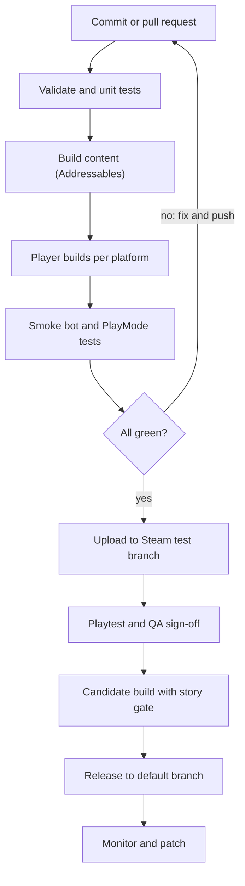

## 12. Deployment and release

### 12.1 Environments and branches

| Environment | Purpose | Source branch | Audience |
| --- | --- | --- | --- |
| Local | Day-to-day development | Feature branches | Developers |
| Integration | Automatic builds of every merge | main | Team |
| Test | A private Steam branch (or equivalent) for QA and external testers | Release candidates | QA, invited playtesters |
| Live | The public release | Tagged release | Players |

Branch policy: feature branches merge by pull request into main after review and green checks. Release candidates are tagged from main. Hotfixes branch from the live tag and merge back.

### 12.2 Build and release pipeline

build and release pipeline · 11 steps, 1 decision

**Reading the diagram.** Every commit is validated and tested. A failed run returns to the author. Only a green build is uploaded to the private test branch, and only a candidate that passes the story gate (every included chapter tagged Verified) can be released.

| Stage | What happens | Tooling |
| --- | --- | --- |
| Validate | Content validation, unit and system tests, code style | Unity Test Framework, editor scripts |
| Build content | Addressables for every chapter | Unity build scripts on the CI agent |
| Player builds | Platform builds, release defines on candidates | GameCI Unity actions, IL2CPP |
| Test | Smoke bot, PlayMode tests, performance capture | CI agents with a GPU where needed |
| Upload | Push to the private branch | Steamworks SteamPipe |
| Sign-off | Playtest and QA gate | Stage-gate checklist |
| Release | Candidate with the story gate, then promote to the default branch | Steamworks |

**CI notes.** Cache the Library folder and package cache to keep builds fast; keep a licence activation for the CI agents; store signing keys and store credentials in the CI secret store; keep build artifacts for at least the last several releases so rollbacks are one click.

### 12.3 Build matrix

| Target | Timing | Notes |
| --- | --- | --- |
| Windows 64-bit (PC, Steam) | Slice onward | Primary target |
| Steam Deck | Test from alpha | Treat as a target device; confirm Valve's current compatibility criteria before claiming it |
| macOS and Linux | Optional, after launch | Only if there is demand |
| Consoles | After the slice proves out | Needs approved developer status, development kits, certification and (for Unity) Pro seats; terms differ per platform holder, so confirm each |

### 12.4 Release checklist

1. **Legal:** licence, voice, music and trademark confirmations in writing; privacy policy; end-user licence.

2. **Ratings:** complete the age-rating questionnaires or classification for each target market; the bible aims for PEGI 7 and ESRB E10+, so check the final content against that.

3. **Store:** Steamworks setup, store page, capsule art, trailer, screenshots, localisation of the store text, pricing. Valve's Steam Direct fee of $100 per app must be paid well ahead: there is a 30-day wait between payment and release.

4. **Features:** achievements, cloud saves, controller support, accessibility tags, Steam Deck testing.

5. **Quality:** no S1 or S2 defects open, performance targets met on the minimum spec, all stage gates passed.

6. **Marketing:** wishlists, a demo of the slice, press and community plan.

7. **Support:** crash reporting on, patch process rehearsed, community channels staffed.

### 12.5 Versioning, patching and rollback

- **Version scheme:** Major.Minor.Patch plus build number. The slice is 0.x; Episode 1 is 1.0; each further episode raises the minor number.

- **Save compatibility:** a save made in any released version must load in every later version (SaveMigrator tests enforce this).

- **Patch cadence:** S1 hotfixes as needed; regular patches every few weeks after launch.

- **Rollback:** keep the previous build available on a Steam branch; promote it back to default if a release is bad.

### 12.6 How episodes can ship

| Model | How it works | Strength | Weakness |
| --- | --- | --- | --- |
| Updates to one app | Episodes added as free or included updates | Simple for players | Revenue only at the first sale |
| Paid DLC per episode | Base game plus episode packs | Revenue per episode | More store and entitlement setup |
| Separate releases | Each episode its own product | Maximum flexibility | Wishlist and community split |

Choose before the slice launch, because it affects the store setup, the save format and the marketing.

### 12.7 Monitoring after launch

Watch crash and diagnostics dashboards (opt-in only), store reviews and forum posts, and completion drop-off data if analytics are enabled with consent. Tag every issue with its chapter so the stage-gate board shows where the game hurts.

### Build and release pipeline (text form)

Only a green build with every chapter verified reaches players.
