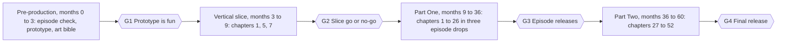

## 13. Project plan, team and milestones

### 13.1 Phases and gates

delivery roadmap · 4 phases, 4 gates

| Phase | Output | Gate to exit |
| --- | --- | --- |
| Pre-production | Episode check on all [I] chapters, tech prototype (movement, combat, Shadow), art bible, pipeline set up | G1: the prototype is fun to play for ten minutes |
| Vertical slice | Chapters 1, 5 and 7 at near-final quality, with every core system in at least basic form | G2: the slice meets the success criteria in section 2; funding and scope are confirmed or changed |
| Part One | Chapters 1 to 26 in three episode drops (1 to 9, 10 to 18, 19 to 26) | G3: each episode passes the quality gates and is released |
| Part Two | Chapters 27 to 52 with the Season 2 systems (Namirash zones, grains, black-hole closing) | G4: final release |

The durations are planning estimates for a team of about 12 to 15 using reuse and the cost tiers in section 3. A larger team shortens the plan; a smaller team lengthens it or reduces scope.

### 13.2 Team and roles

| Role | Pre-production | Slice | Production |
| --- | --- | --- | --- |
| Game director and producer | 2 | 2 | 2 |
| Narrative lead and writer | 1 | 1 to 2 | 2 |
| Designers (systems, level, combat) | 2 | 3 | 4 |
| Programmers (gameplay, AI, tools, build) | 2 | 3 | 4 |
| Artists (character, environment, VFX, UI) | 2 | 4 | 6 |
| Animators | 1 | 2 | 3 |
| Audio (composer, sound design) | 0 to 1 | 1 | 1 to 2 |
| QA | 0 to 1 | 1 | 2 |

Headcounts are indicative per phase. Contractors can cover audio, localisation, cinematics and QA peaks.

### 13.3 Working rhythm

- **Sprints:** two weeks, planned from the Chapter Board, with every chapter at one of the stage-gate steps in section 6.3.

- **Weekly build review:** the whole team plays the latest build for thirty minutes.

- **Monthly playtest:** a small outside group plays the newest chapters.

- **Stage-gate review:** a chapter cannot move to the next stage without the gate evidence (a recording, a test run or a sign-off).

- **Cut list:** a ranked list of chapters and features that can be simplified, agreed before production starts, so cuts are planned rather than panicked.

### 13.4 If the team is small

A team of one to five cannot build 52 chapters in five years at this scope, so shrink the problem rather than the quality.

1. **Ship the slice first** as a free or low-priced demo; this proves the idea and finds supporters.

2. **Shorten chapters** to 10 to 15 minutes and make several Tier C.

3. **Reuse aggressively:** one hub controller, three level kits, one boss framework.

4. **Buy, do not build,** where the result is not the game's identity: dialogue tools, UI kits, environment packs, base animation sets, with a licence check on each.

5. **Release Episode 1 only** and let its results decide the next episode.

6. **Keep the story gate:** the pipeline's most valuable feature is that no chapter ships unverified.

### 13.5 Budget lines

Budget as: people (the bulk), tools and licences, outsourced art and audio, localisation and voice, QA and certification, store fees, marketing and community, and a contingency of at least 15 to 20 percent. Use the cost tiers (section 3) to estimate people-time per chapter and the roadmap above to spread it over months. Exact figures depend on the studio's location and salaries and are left to the producer.

### Delivery roadmap (text form)

